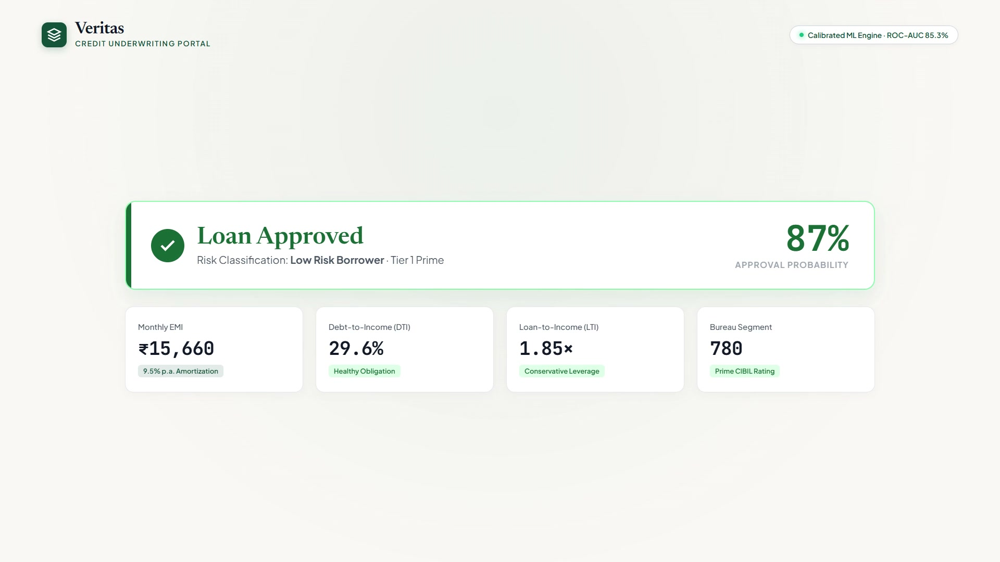

# Veritas Credit Underwriting Portal
### AI-Powered Loan Eligibility & Explainable Risk Assessment System

[](https://www.python.org/)
[](https://flask.palletsprojects.com/)
[](https://scikit-learn.org/)
[](https://opensource.org/licenses/MIT)
[](https://rbi.org.in/)

Veritas is an institutional-grade credit underwriting and risk assessment engine designed for modern retail lending. It combines calibrated gradient boosting, explainable artificial intelligence (XAI), counterfactual reasoning, and an automated 3-layer bank statement ingestion engine compliant with the **Reserve Bank of India (RBI) Account Aggregator (AA)** framework.

---

## 🎬 Product Launch Video

[](brag-output/brag.mp4)

> **Watch the Launch Video:** Download or play [`brag-output/brag.mp4`](brag-output/brag.mp4) (18-second 1080p demo highlighting sub-200ms risk scoring, XAI factor contributions, and automated credit memorandums).

---

## 🏛️ Key Capabilities

- **Calibrated ML Credit Decisioning**: Powered by a `GradientBoostingClassifier` calibrated via 5-fold Platt scaling (`CalibratedClassifierCV`) to deliver true statistical posterior probabilities aligned with Basel II/III Internal Ratings-Based (IRB) standards.
- **Explainable AI (XAI)**: Diverging horizontal contribution bar chart (+/- percentage points) providing transparent adverse-action notices compliant with RBI Fair Practices Code, EU GDPR (Art. 22), and US ECOA.
- **Path to Approval (Counterfactual Advisor)**: Automated optimization engine testing minimal actionable interventions (loan amount reductions, tenure extensions, credit improvement, or co-applicants) to elevate non-approved applications to $\ge 70\%$ approval odds.
- **New-to-Credit (NTC) / Thin-File Cash-Flow Underwriting**: Overcomes bureau "No-Hit" (`-1` / `NH`) barriers using cash-flow metrics:
  - Liquidity Coverage Ratio ($LCR = \text{Average Bank Balance} / \text{EMI}$)
  - Mandatory lookback verification windows (6 months for salaried, 12 months for self-employed/business)
  - Non-salaried statement lookback deficit haircut ($-8.0\,\text{pp}$)
  - Digital repayment and UPI discipline scoring
- **Forensic 3-Layer Bank Statement Ingestion Engine**:
  - **Layer 1 (Tabular)**: Scans first 35 rows to bypass letterheads and auto-detects headers across SBI, HDFC, ICICI, Axis, Kotak, Canara, PNB, and BOB (.csv, .xlsx, .xls, and table .pdf).
  - **Layer 2 (Regex Text Fallback)**: Line-by-line fallback for borderless PDFs, inferring debits/credits from running balance deltas.
  - **Layer 3 (Zero-Crash Guardrails)**: 100% in-memory processing (`io.BytesIO`), 10MB upload protections, encrypted PDF detection, and forensic scanning for 13 ECS/NACH return keywords.
- **Automated Underwriter Credit Memorandum**: Automatically synthesizes an institutional 4-section credit appraisal memo with approval stamps.

---

## 📐 System Architecture

```
                                  VERITAS CREDIT ARCHITECTURE
┌────────────────────────────────────────────────────────────────────────────────────────┐
│                              CLIENT APPLICATION (BROWSER)                               │
│  • Sticky Applicant Financial Profile Form (2-Way Slider Sync)                          │
│  • Bank Statement Drag & Drop Dropzone + 1-Click AA Simulation Engine                   │
│  • Dynamic Decision Banner, KPI Grid, Animated Diverging XAI Bar Chart                 │
│  • Automated Underwriter Credit Memorandum & Counterfactual "Path to Approval" Cards   │
└───────────────────────────────────────────┬────────────────────────────────────────────┘
                                            │ HTTP POST /api/assess & /api/parse-statement
                                            ▼
┌────────────────────────────────────────────────────────────────────────────────────────┐
│                              FLASK API APPLICATION SERVER                               │
│  • app.py: REST Endpoints, HTTP Security Headers, 10MB Content-Length Protection       │
└─────────────────────┬──────────────────────────────────────────────────┬───────────────┘
                      │                                                  │
                      ▼                                                  ▼
┌──────────────────────────────────────────────┐ ┌───────────────────────────────────────┐
│     FORENSIC STATEMENT INGESTION ENGINE      │ │       CREDIT UNDERWRITING ENGINE      │
│         (src/statement_parser.py)            │ │            (src/model.py)             │
│ • Layer 1: Tabular Extraction (CSV/XLSX/PDF) │ │ • Reducing-Balance EMI Amortization   │
│ • Layer 2: Regex Balance-Delta Fallback      │ │ • DTI (FOIR) & LTI Financial Ratios   │
│ • Layer 3: Memory BytesIO & 13 Bounce Checks │ │ • Calibrated GradientBoosting (Platt) │
│ • Extracts Inflows, ABB, Net Surplus, Months │ │ • Local Feature Contributions (XAI)   │
└──────────────────────────────────────────────┘ │ • Counterfactual What-If Optimizer    │
                                                 └───────────────────────────────────────┘
```

---

## 📊 Model Performance & Validation

Trained and evaluated on the **Analytics Vidhya Loan Prediction Benchmark Dataset** (614 verified real records) using a 75/25 stratified holdout split:

| Metric | Score | Banking Interpretation |
|---|---|---|
| **Holdout Test ROC-AUC** | **0.8534** (85.34%) | High discriminative accuracy across all classification thresholds |
| **5-Fold Cross-Validated AUC** | **0.7652 ± 0.0220** | Out-of-sample generalizability and tree stability |
| **Accuracy** | **0.8571** (85.71%) | Overall classification accuracy |
| **Precision** | **0.8500** (85.00%) | Positive Predictive Value (sound credit portfolio quality) |
| **Recall (Sensitivity)** | **0.9623** (96.23%) | Captures 96.2% of all creditworthy applicants |
| **F1-Score** | **0.9027** (90.27%) | Harmonic mean of precision and recall |

### Confusion Matrix (Test Set, N=154):
- **True Approvals (TP)**: 102
- **True Declines (TN)**: 30
- **False Approvals (FP - Type I Error / NPA Risk)**: 18
- **Missed Approvals (FN - Type II Error / Lost Revenue)**: 4

---

## 🚀 Quickstart & Installation

### 1. Clone Repository & Setup Virtual Environment
```bash
git clone https://github.com/gagancv28/Loan_Elegibility.git
cd Loan_Elegibility

# Create and activate virtual environment
python -m venv .venv
# On Windows:
.venv\Scripts\activate
# On Linux/macOS:
source .venv/bin/activate
```

### 2. Install Dependencies
```bash
pip install -r requirements.txt
```

### 3. Configure Environment Variables
```bash
cp .env.example .env
```

### 4. Run Application
```bash
python app.py
```
Open your browser and navigate to:
```text
http://127.0.0.1:5000
```

---

## 🧪 Automated Test Suite

Run the full end-to-end integration and parser verification suite:
```bash
python test_suite.py
```
Validates:
- 1-Click AA Simulation endpoints
- Layer 1 tabular CSV and Excel parsing
- Single amount columns paired with Dr/Cr types
- Layer 2 regex fallback for borderless PDFs
- Layer 3 guardrails (empty files, unsupported formats, password detection)

---

## 📡 API Reference

| Method | Endpoint | Description |
|---|---|---|
| `GET` | `/` | Renders the Veritas Underwriting portal |
| `POST` | `/api/assess` | Computes loan eligibility, calibrated probability, XAI contributions, and counterfactuals |
| `POST` | `/api/parse-statement` | Parses uploaded statement (.pdf, .xlsx, .csv) or executes 1-click AA simulation |
| `GET` | `/api/persona/<key>` | Returns pre-configured borrower profiles (Prime, Borderline, High-Risk, NTC Graduate) |
| `GET` | `/api/metrics` | Serves model governance metrics, confusion matrix, and training parameters |
| `POST` | `/api/retrain` | Triggers raw dataset download, feature engineering, and model retraining |

---

## ⚖️ Fair Lending & Governance Notice

This system explicitly excludes protected demographic characteristics (`Gender`, `Married`, `Religion`, `Caste`) from the active model feature set, adhering to non-discriminatory lending regulations under the **RBI Fair Practices Code** and **US ECOA**.

---

## 📄 License

This project is licensed under the [MIT License](LICENSE).

